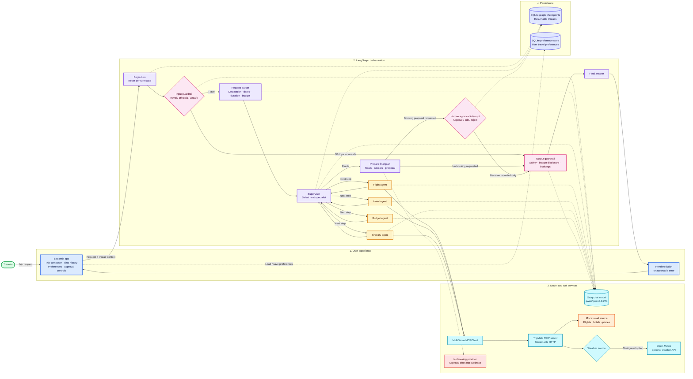

# TripMate Architecture

This diagram reflects the current repository implementation. Solid arrows show the request flow; dashed arrows show model calls or persistence. Flight, hotel, and place search currently use mock data. Weather uses mock data by default, with an optional Open-Meteo source.



## Component responsibilities

| Component | Responsibility |
| --- | --- |
| Streamlit | Collects trip requests, displays conversation history, edits preferences, and presents approval controls. |
| LangGraph | Runs input checks, parses trip details, routes among specialist agents, prepares the plan, and reviews the final response. |
| Groq | Supplies the chat model used by the guardrails, parser, supervisor, and agents. |
| TripMate MCP | Exposes flight, hotel, weather, and place tools to the specialist agents. |
| SQLite | Stores resumable graph checkpoints and long-term user preferences. |
| Booking approval | Records an approve/edit/reject decision. It does not submit a reservation or payment. |

## Data and integration boundaries

- Flight, hotel, and place results are generated by `MockTravelDataSource`; they are samples, not live offers or availability.
- Weather is mock-backed by default. Setting `TRIPMATE_DATA_SOURCE=open-meteo` switches only the weather lookup to Open-Meteo.
- The configured MCP server is TripMate's own server. The Amadeus MCP server is not wired into this graph; it provides flight search only and does not provide hotel search or booking.
- A booking request creates a reviewable proposal and pauses for human input. There is no booking execution provider connected.

## Local runtime

Run the MCP server and Streamlit UI in separate terminals:

```powershell
python -m tripmate.mcp_servers.server
streamlit run streamlit_app.py
```